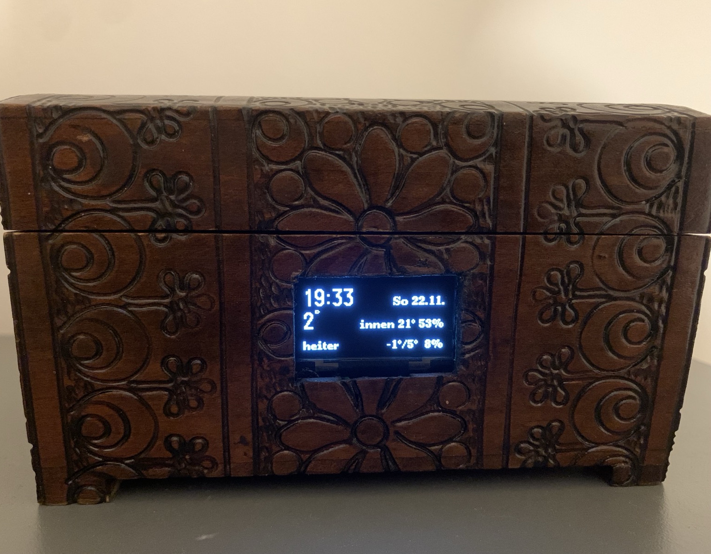

## Description

A custom departure board: a display showing live departures for public transport network (HVV), plus a scrolling banner for active service disruptions. A second view shows time, weather and indoor climate.

*departure view with scrolling disruption banner*

*departure view*

*weather view: time, date, outdoor temperature and conditions, indoor temperature and humidity, daily min/max and chance of rain*

## Features

- departure view: next bus and train with live delays, plus a scrolling banner for disruptions
- weather view: time, date, outdoor weather from open-meteo, indoor temperature and humidity
- push button switches between both views
- yellow LED reminds you to open a window when indoor humidity reaches 60% to prevent mold, turns off again below 55%
- display and LED sleep at night

## Hardware

- ESP32 dev board
- SH1106 1.3" I2C OLED display
- push button between GPIO 27 and GND to switch between departures and weather
- DHT11 sensor on GPIO 26 for indoor temperature and humidity
- yellow LED with 330Ω resistor on GPIO 25, lights up when humidity is too high and a window should be opened

## Configuration

configurations and secrets live in gitignored `include/imhr_secrets.h`, including the weather location (`WEATHER_LATITUDE`, `WEATHER_LONGITUDE`)
