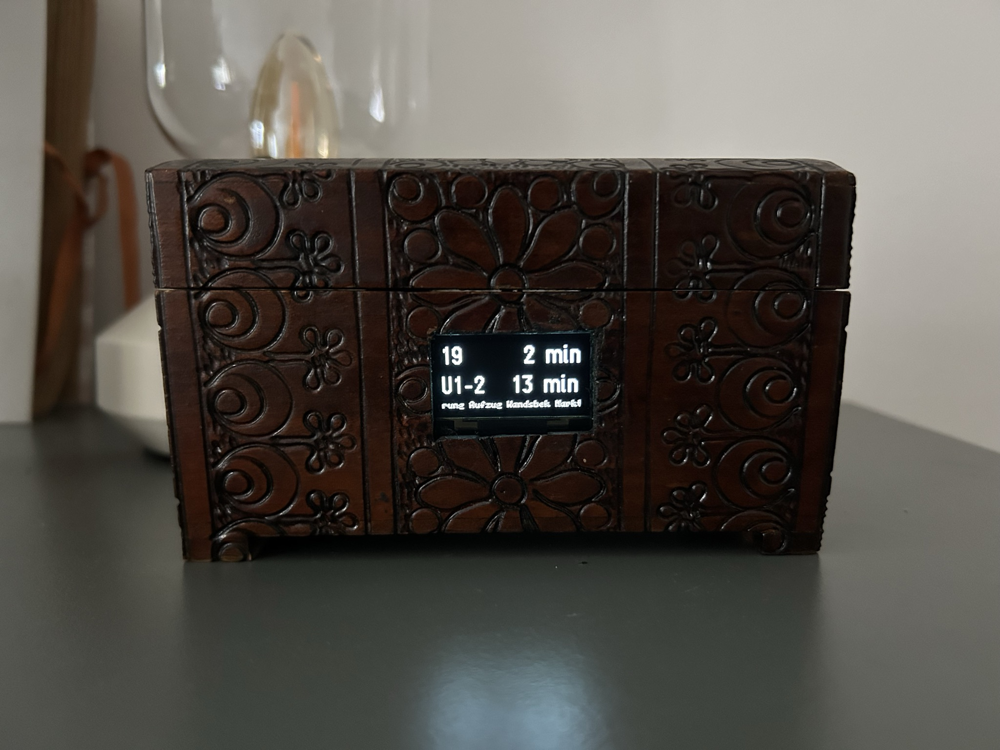

## Description

A custom departure board: a display showing live departures for public transport network (HVV), plus a scrolling banner for active service disruptions.

## Hardware

- ESP32 dev board
- SH1106 1.3" I2C OLED display
- push button between GPIO 27 and GND to switch between departures and weather
- DHT11 sensor on GPIO 26 for indoor temperature

## Configuration

configurations and secrets live in gitignored `include/imhr_secrets.h`
